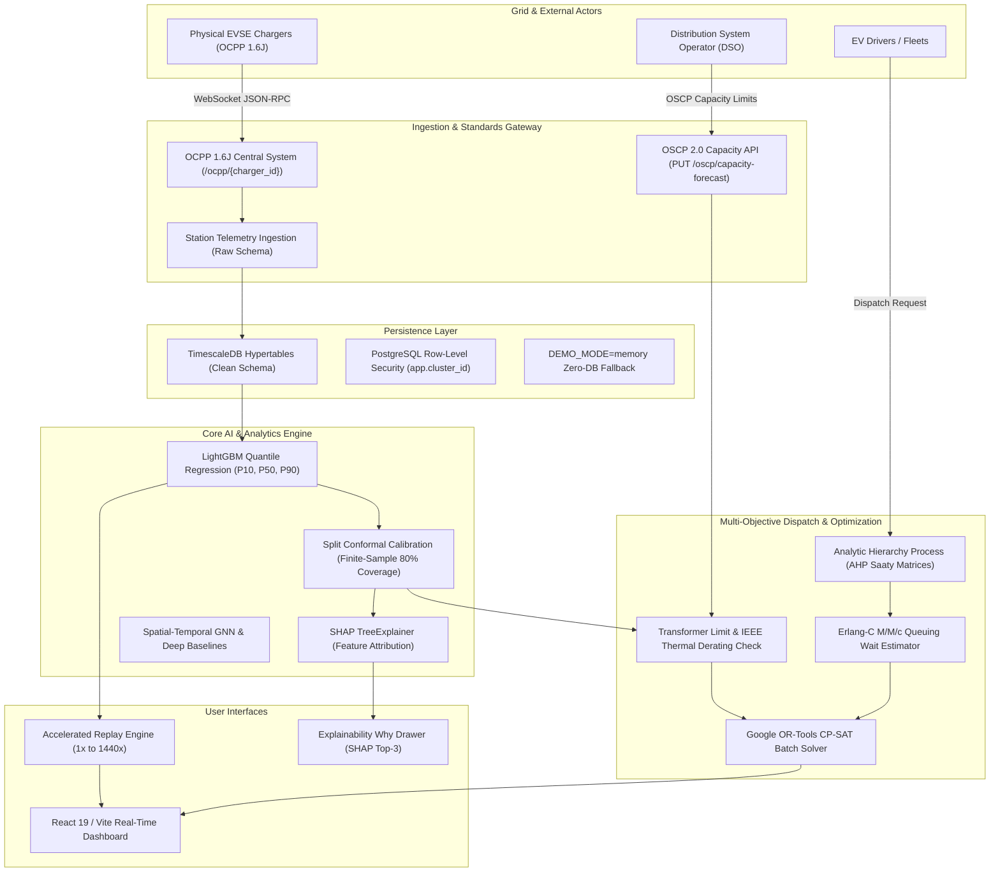

# EV Cluster Load Architecture

## 1. System Overview

**EV Cluster Load** is an end-to-end AI-powered EV charging cluster load prediction and multi-objective dispatch system designed for distribution grid congestion management. It couples calibrated quantile forecasting with discrete-event optimization and standards-compliant charge point communication.

---

## 2. Layer Deep-Dive

### 2.1 Central System & Standards Layer
- **OCPP 1.6J**: Implements RFC 6455 WebSocket JSON-RPC 2.0 arrays (`[2, unique_id, action, payload]`) with `ocpp1.6` subprotocol. Handles `BootNotification`, `StatusNotification`, `StartTransaction`, `MeterValues`, and `StopTransaction`.
- **OSCP 2.0 (Open Smart Charging Protocol)**: Provides `PUT /oscp/capacity-forecast` allowing DSOs to set dynamic, time-varying substation headroom limits. Features sub-tick overload detection that triggers immediate alerts when headroom drops below active cluster load.

### 2.2 Probabilistic Machine Learning Pipeline
- **LightGBM Quantile Regressors**: Trains three independent Gradient Boosted Decision Tree models targeting $\alpha \in \{0.10, 0.50, 0.90\}$ quantiles.
- **Split Conformal Prediction**: Calibrates prediction intervals using non-conformity scores computed on an independent holdout calibration split, guaranteeing $\ge 80\%$ marginal coverage with exact finite-sample validity without normality assumptions.
- **TreeSHAP Explainability**: Pre-computes exact game-theoretic Shapley values via `shap.TreeExplainer` for every candidate slot, surfacing the top-3 influential drivers (e.g., historical peak hour, ambient heatwave, queue saturation).

### 2.3 Optimization & Grid Protection
- **Multi-Objective Dispatch Formulation**:
  $$J = w_{\text{wait}} \cdot \text{WaitTime} + w_{\text{detour}} \cdot \text{DetourTime} + w_{\text{grid}} \cdot \text{TransformerRisk}$$
- **AHP Pairwise Matrices**: Uses Saaty's eigenvector method with consistency checks ($CR < 0.10$) across driver profiles (`fastest`, `balanced`, `grid_friendly`).
- **Google OR-Tools CP-SAT**: Solves multi-driver batch routing assignments under station bay capacities and hard transformer kVA limits ($<90\%$).
- **Thermal Derating & Power Flow**: Incorporates IEEE C57.91 / IEC 60076-7 thermal derating curves and cross-validates line impedances and voltage drops using `pandapower` AC load flow.

### 2.4 Data and Security Architecture
- **TimescaleDB Partitioned Hypertables**: Telemetry and sessions partitioned by timestamp with chunk intervals for fast analytical queries.
- **Zero-DB In-Memory Fallback**: When `DEMO_MODE=memory`, all services operate in pure Python memory structures with exact JSON shape parity.
- **Enterprise Security**: Argon2id password hashing, RS256/HS256 JWT bearer tokens, and PostgreSQL Row-Level Security (RLS) scoping multi-tenant operators to their designated cluster.
