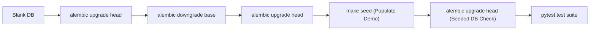

# Database Migration Strategy & Lifecycle

This document describes the database migration architecture, Alembic conventions, TimescaleDB DDL rules, reversible downgrade testing, and the zero-downtime **Expand-then-Contract** schema evolution pattern.

---

## 1. Alembic Architecture & Configuration

EV Cluster Load manages schema evolution using [Alembic](https://alembic.sqlalchemy.org/) under `backend/alembic/`.

- **Migration Scripts**: Stored in `backend/alembic/versions/`.
- **Revision Naming Template**:
  ```ini
  file_template = %%(year)d_%%(month).2d_%%(day).2d_%%(hour).2d%%(minute).2d-%%(rev)s_%%(slug)s
  ```
  Guarantees chronological sorting of migration files.
- **Multi-Schema Support**: Configured with `include_schemas=True` in `backend/alembic/env.py` to manage `raw`, `clean`, and `features` schemas simultaneously.
- **Environment Override**: Automatically respects `DATABASE_URL` from environment variables, normalizing connection strings for SQLAlchemy 2.0+ and `psycopg3`.

---

## 2. Explicit Constraint Naming Conventions

To prevent inconsistent, auto-generated constraint names across PostgreSQL instances, all SQLAlchemy models and migrations enforce an explicit constraint naming convention in `backend/app/db/connection.py`:

```python
NAMING_CONVENTION = {
    "ix": "ix_%(column_0_label)s",
    "uq": "uq_%(table_name)s_%(column_0_name)s",
    "ck": "ck_%(table_name)s_%(constraint_name)s",
    "fk": "fk_%(table_name)s_%(column_0_name)s_%(referred_table_name)s",
    "pk": "pk_%(table_name)s",
}
```

This guarantees:
- Predictable index and constraint names in database catalogs.
- Safe automated migrations without collision or missing constraint errors.
- Unambiguous `ALTER TABLE ... DROP CONSTRAINT ...` execution in migration downgrades.

---

## 3. TimescaleDB DDL Through `op.execute`

TimescaleDB features (hypertables, retention policies, compression, continuous aggregates) exist outside standard ANSI SQL and standard SQLAlchemy DDL constructs.

### Hypertable Rules
1. **Partitioning Column in Primary Key**:
   TimescaleDB requires that the partitioning time column be part of any unique or primary key constraint on the table.
   ```python
   # Example: clean.sessions
   sa.PrimaryKeyConstraint("id", "start_time")
   ```
2. **Execution via `op.execute`**:
   Hypertables are created explicitly via `op.execute`:
   ```python
   op.execute("SELECT create_hypertable('clean.sessions', 'start_time', if_not_exists => TRUE);")
   op.execute("SELECT create_hypertable('clean.station_load', 'timestamp', if_not_exists => TRUE);")
   op.execute("SELECT create_hypertable('clean.weather', 'timestamp', if_not_exists => TRUE);")
   op.execute("SELECT create_hypertable('clean.forecasts', 'target_ts', if_not_exists => TRUE);")
   ```
3. **Reversible Drops**:
   Dropping a hypertable with `op.drop_table(..., schema="clean")` automatically cascades and unregisters the hypertable from `_timescaledb_catalog` cleanly.

---

## 4. Separation of Concerns: Migrations vs. Seed Data

A strict engineering boundary is maintained:
- **Migrations (`alembic upgrade head` / `make migrate`)**:
  - Exclusively DDL (`CREATE`, `ALTER`, `DROP`, constraints, extensions, indexes).
  - Absolutely **NO** demo data, mock sessions, or test fixtures are inserted.
  - Safe to run in production without mutating application state.
- **Seeding (`python -m app.db.seed` / `make seed`)**:
  - Externalized into dedicated idempotent seeder modules.
  - Generates demo cluster topologies, synthetic sessions, and benchmark configurations.
  - Guaranteed idempotent: running `make seed` repeatedly yields identical row counts.

---

## 5. Reversible Downgrades & CI Lifecycle Testing

Every migration script **must** implement a fully verified `downgrade()` function.

### Automated CI Lifecycle Test
GitHub Actions (`.github/workflows/ci.yml`) runs a continuous validation pipeline on every push and pull request against PostgreSQL 16 + TimescaleDB + PostGIS:



1. **Apply to blank DB**: Ensures new instances provision from scratch.
2. **Reversible downgrade**: `alembic downgrade base` tears down all objects back to a clean state.
3. **Re-upgrade**: `alembic upgrade head` validates that a rolled-back database can be re-provisioned cleanly.
4. **Seed database**: Populates cluster configuration and historical data.
5. **Re-apply on seeded database**: Confirms that already-seeded databases tolerate migration checks without data corruption.
6. **Integration tests**: Confirms that models and hypertables match application expectations.

---

## 6. The Expand-Then-Contract Pattern (Zero-Downtime Evolution)

For 24/7 critical grid infrastructure and continuous EV charging dispatch, downtime for schema migrations is unacceptable. Schema changes follow the **Expand-then-Contract** pattern:

### Step 1: Expand (Non-breaking additive change)
- Add new columns as **nullable** or with safe default values.
- Add new tables or views without altering existing columns.
- **Example**: Migrating charger power rating from single `max_kw` to three-phase attributes:
  ```python
  # Migration V1 (Expand)
  op.add_column("chargers", sa.Column("rated_kw", sa.Float(), nullable=True), schema="clean")
  ```

### Step 2: Dual-Writing & Backfill (Application Layer)
- Deploy application update:
  - Application writes to both `max_kw` (old) and `rated_kw` (new).
  - Application reads from `max_kw` (with fallback to `rated_kw`).
- Run a background script or idempotent task to backfill historical rows:
  ```sql
  UPDATE clean.chargers SET rated_kw = max_kw WHERE rated_kw IS NULL;
  ```

### Step 3: Contract (Removal of obsolete constructs)
- Deploy next application update:
  - Application reads and writes exclusively to `rated_kw`.
- Run final migration to enforce constraints and drop deprecated columns:
  ```python
  # Migration V2 (Contract)
  op.alter_column("chargers", "rated_kw", nullable=False, schema="clean")
  op.drop_column("chargers", "max_kw", schema="clean")
  ```

This pattern ensures that rolling deployments, multi-instance web servers, and edge IoT devices never encounter breaking schema changes during deployments.
