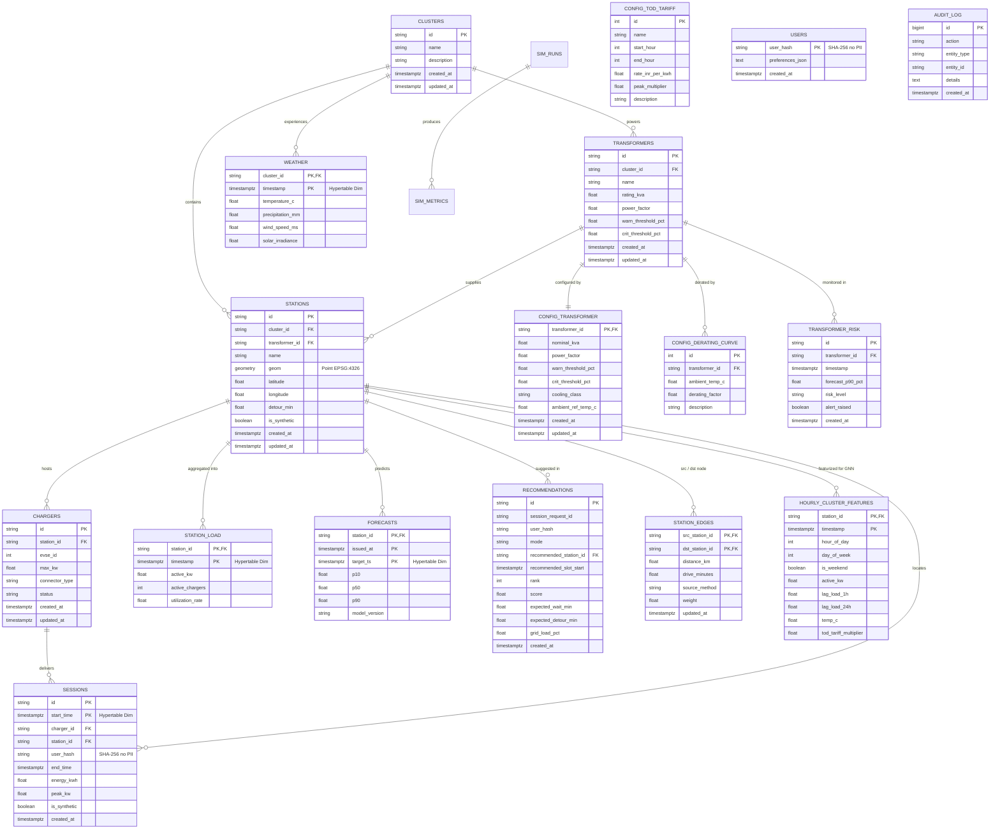

# EV Cluster Load Database Schema

This document details the relational entity relationships and hypertable structure across the three architectural schemas: `raw`, `clean`, and `features`.

## Entity-Relationship Diagram

## TimescaleDB Hypertables
The following tables are partitioned by time to support high-throughput ingestion and sub-second analytical queries:
1. `clean.sessions` (partitioned on `start_time`)
2. `clean.station_load` (partitioned on `timestamp`)
3. `clean.weather` (partitioned on `timestamp`)
4. `clean.forecasts` (partitioned on `target_ts`)
