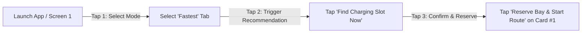

# EV Cluster Load — UI/UX Design Brief

## 1. Executive Summary

This design brief establishes the user experience architecture, design system tokens, screen layouts, and accessibility guidelines for the **EV Cluster Load** platform. 

The system serves two distinct user groups with contrasting operational environments:
1. **An EV driver on a mobile phone** who needs a reliable, queue-free charging recommendation in minimum time and cognitive load.
2. **A substation grid operator in a control room** who monitors a 100 kVA transformer feeding 4 charging stations, balancing peak loads and mitigating overload risks at 80% warning and 90% critical thresholds.

---

## 2. User Personas

### Persona 1: Ananya — Mobile EV Commuter
- **Role**: Daily EV driver (Tata Nexon EV, 30 kWh battery).
- **Context & Environment**: In-car mobile phone mount, city traffic (Bangalore), bright daytime glare, 22% battery state-of-charge.
- **Mental Model**: *"I need a charger nearby right now where I don't have to wait in line, and that won't make me detour 20 minutes."*
- **Primary Pain Points**:
  - Arriving at a station only to find all bays occupied.
  - Complicated multi-step filters while parked or stopped at traffic lights.
  - Unclear pricing and unexpected wait times.
- **Key Task & Acceptance Metric**:
  - **Reaches an optimized Top-3 recommendation in exactly 3 taps from app launch.**
- **Device & Form Factor**: 390×844 px (iOS / Android smartphone), single-handed thumb zone.

---

### Persona 2: Vikram — Substation Grid Operator
- **Role**: Distribution Substation Control Room Operator (BESCOM Metro Central Cluster).
- **Context & Environment**: Multi-monitor desktop console (1920×1080 / 2560×1440), dimly lit control room, shift-based monitoring.
- **Mental Model**: *"I must ensure the 100 kVA distribution transformer never stays above 90% capacity, especially during evening peak hours and hot ambient days."*
- **Primary Pain Points**:
  - Delayed awareness of sudden concurrent EV charging spikes.
  - Lack of actionable lookahead forecasts (needs P10/P50/P90 confidence intervals).
  - Difficulty quantifying whether Smart Dispatch recommendations are effectively shaving peaks compared to unmanaged FCFS arrivals.
- **Key Task**: Real-time transformer risk surveillance, ambient temperature derating monitoring, 24-hour lookahead alert response, and 60x simulation replay evaluation.
- **Device & Form Factor**: High-density desktop dashboard, keyboard and mouse interaction.

---

## 3. Design System & Design Tokens

### 3.1 Color Palette & Semantic Tokens

Designed for high contrast, dark-room control consoles, sunlight readability, and full color-blind safety (never using color alone for state).

| Token Name | Hex Value | Semantic Role | Contrast vs Ink-900 | WCAG AA / AAA |
|---|---|---|---|---|
| `--color-ink-900` | `#0A1F24` | Primary Deep Teal Ink (Dark background / text ink) | Base | Base |
| `--color-ink-800` | `#102D34` | Secondary Deep Teal Ink (Card surface / container) | — | Surface |
| `--color-ink-700` | `#183E47` | Elevated Deep Teal (Borders, dividers, interactive hover) | — | Border |
| `--color-ink-100` | `#E2F1F3` | Primary text light / High contrast on ink | 13.8:1 | Pass (AAA) |
| `--color-ink-300` | `#9BB7BC` | Secondary text / metadata | 6.8:1 | Pass (AA) |
| `--color-trafo-blue` | `#1E88E5` | Transformer Blue (Primary brand, electrical assets) | 4.9:1 | Pass (AA) |
| `--color-trafo-blue-hover` | `#1565C0` | Transformer Blue interactive active state | 5.8:1 | Pass (AA) |
| `--color-trafo-blue-tint` | `#E3F2FD` | Light blue background fill for active badges | 11.2:1 (on dark) | Pass (AAA) |
| `--color-warn-amber` | `#D97706` | **80% Warning Threshold** (Alert icon + badge) | 5.2:1 | Pass (AA) |
| `--color-warn-amber-bg` | `#451A03` | Dark-mode Warning surface tint | — | Surface |
| `--color-crit-red` | `#DC2626` | **90% Critical Threshold** (Overload warning + halt) | 4.8:1 | Pass (AA) |
| `--color-crit-red-bg` | `#450A0A` | Dark-mode Critical surface tint | — | Surface |
| `--color-safe-green` | `#059669` | Feasible / Available (< 80% loading) | 5.5:1 | Pass (AA) |
| `--color-safe-green-bg` | `#064E3B` | Safe container background | — | Surface |

### 3.2 Typography: Atkinson Hyperlegible
Selected for unambiguous character legibility under extreme conditions (distinguishing ambiguous glyph pairs: `0` vs `O`, `1` vs `l` vs `I`, `8` vs `B`, and station codes `S1` / `S2` / `S3` / `S4`).

```css
@import url('https://fonts.googleapis.com/css2?family=Atkinson+Hyperlegible:ital,wght@0,400;0,700;1,400;1,700&display=swap');

:root {
  --font-family: 'Atkinson Hyperlegible', -apple-system, BlinkMacSystemFont, sans-serif;
  --font-mono: 'JetBrains Mono', 'Consolas', monospace; /* Used for telemetry digits */

  /* Scale */
  --text-xs:   0.75rem;   /* 12px - Captions, unit labels */
  --text-sm:   0.875rem;  /* 14px - Body secondary, table cells */
  --text-base: 1.000rem;  /* 16px - Body primary, form controls */
  --text-lg:   1.125rem;  /* 18px - Subheadings, card titles */
  --text-xl:   1.250rem;  /* 20px - Screen headers, modal titles */
  --text-2xl:  1.500rem;  /* 24px - Section headlines */
  --text-3xl:  2.000rem;  /* 32px - Metric KPIs, big numbers */
}
```

### 3.3 Accessibility & Usability Directives
- **WCAG 2.1 AA Compliance**: All text elements adhere to $\ge 4.5:1$ contrast ratio for body text and $\ge 3:1$ for large headings / graphical icons.
- **Unambiguous Visible Focus**: All interactive controls (`button`, `a`, `input`, `select`, `[tabindex]`) display a high-visibility focus ring:
  ```css
  :focus-visible {
    outline: 2px solid var(--color-trafo-blue);
    outline-offset: 2px;
  }
  ```
- **Colour-Blind Safety (Dual Encoding)**:
  - Severity is **never conveyed by color alone**:
    - **Safe (<80%)**: Green `#059669` + Checkmark `[✓]` + Text `"NORMAL"`
    - **Warning (80%-90%)**: Amber `#D97706` + Warning Triangle `[⚠]` + Text `"WARN (80%)"`
    - **Critical (≥90%)**: Red `#DC2626` + Danger Hexagon `[⛔]` + Text `"CRITICAL (90%)"`
  - Timeseries chart lines utilize distinct stroke patterns:
    - **P50 (Median)**: Solid line `──────` (2px)
    - **P90 (Worst case)**: Dashed line `─ ─ ─ ─` (2px)
    - **P10 (Optimistic)**: Dotted line `·······` (1.5px)
- **Touch Ergonomics**: All interactive elements on mobile have minimum dimensions of $48 \times 48\text{ px}$ with $\ge 8\text{ px}$ separation.

---

## 4. Screen Specifications & Text Wireframes

### Screen 1: Recommend (Mobile / Driver View)
- **Primary Goal**: Fast smart charging recommendation.
- **Acceptance Requirement**: **3 Taps from launch to confirmed slot reservation.**
- **Interaction Walk-Through**:
  - **Tap 1**: Select Driver Priority Mode (Default: `[⚡ Fastest]` pre-selected).
  - **Tap 2**: Tap Primary Action Button `[ FIND CHARGER NOW ]`.
  - **Tap 3**: Tap `[ RESERVE ]` on the Top-Ranked Candidate Card (#1).

```text
+-------------------------------------------------------------+
|  [⚡ EV CLUSTER LOAD]                      [Profile: Driver] |
|  Metro Central Cluster • 100 kVA Transformer                |
+-------------------------------------------------------------+
|                                                             |
|  STEP 1: SELECT PRIORITY MODE (Tap 1)                       |
|  +--------------------+------------------+----------------+ |
|  | [*] ⚡ Fastest      | [ ] ⚖️ Balanced   | [ ] 🌱 Grid    | |
|  |     Min Wait Time  |     Wait+Detour  |     Protect TX | |
|  +--------------------+------------------+----------------+ |
|                                                             |
|  DEPARTURE / ARRIVAL TIME                                   |
|  [ Now (14:00) ▼ ]              Looking ahead: Next 4 hours  |
|                                                             |
|  +--------------------------------------------------------+ |
|  |  >>> [ ⚡ FIND CHARGING SLOT NOW ] <<<         (Tap 2) | |
|  +--------------------------------------------------------+ |
|                                                             |
|  RECOMMENDED SLOTS FOR YOU:                                 |
|                                                             |
|  +========================================================+ |
|  | #1 RECOMMENDED                                [✓ BEST] | |
|  | Market Road Station (S1) • 8 Bays (4 Available)        | |
|  | ------------------------------------------------------ | |
|  | ⏱️ Wait: 0 min (Erlang-C)    🚗 Detour: 0 min          | |
|  | ⚡ Charger: 7.4 kW Type 2   🔋 Arrival: 14:00 (Immediate)|
|  | 📊 Grid Load: 52.0%        [✓ NORMAL (<80%)]           | |
|  | Score: J = 0.120 (Min Cost)                            | |
|  |                                                        | |
|  | +----------------------------------------------------+ | |
|  | |  [ ⚡ RESERVE BAY & START ROUTE ]        (Tap 3)   | | |
|  | +----------------------------------------------------+ | |
|  +========================================================+ |
|                                                             |
|  +--------------------------------------------------------+ |
|  | #2 ALTERNATIVE                                         | |
|  | Station Plaza (S2) • 6 Bays (2 Available)              | |
|  | ⏱️ Wait: 4.2 min          🚗 Detour: +4 min (1.8 km)   | |
|  | 📊 Grid Load: 56.4%        [✓ NORMAL (<80%)]           | |
|  | [ View Details ]                                       | |
|  +--------------------------------------------------------+ |
|                                                             |
|  +--------------------------------------------------------+ |
|  | #3 ALTERNATIVE                                         | |
|  | College Gate (S3) • 6 Bays (1 Available)               | |
|  | ⏱️ Wait: 8.5 min          🚗 Detour: +7 min (3.2 km)   | |
|  | 📊 Grid Load: 68.2%        [✓ NORMAL (<80%)]           | |
|  | [ View Details ]                                       | |
|  +--------------------------------------------------------+ |
+-------------------------------------------------------------+
|  [⚡ Recommend]   [🗺️ Cluster Map]   [ℹ️ Status]   [⚙️ Settings]
+-------------------------------------------------------------+
```

---

### Screen 2: Cluster Map (Geospatial Topology View)
- **Primary Goal**: Spatio-temporal view of the charging network and substation electrical topology.
- **Audience**: Drivers inspecting surrounding stations; Operators inspecting feeder layout.

```text
+---------------------------------------------------------------------------------------------------+
| [⚡ EV CLUSTER LOAD]   Cluster Map: Metro Central (C1)                      [Operator: Vikram | 🟢 Live] |
+---------------------------------------------------------------------------------------------------+
|  FEEDER TOPOLOGY (11 / 0.415 kV Substation TX-Metro-100kVA)                                       |
|                                                                                                   |
|                      [ SUBSTATION TRANSFORMER: T1 ]                                               |
|                      Rating: 100 kVA | Load: 74.2 kW (78.1%) [✓ NORMAL]                           |
|                                   │                                                               |
|          ┌────────────────────────┼────────────────────────┬────────────────────────┐             |
|          │ 1.2 km (4 min)         │ 0.0 km (0 min)         │ 2.4 km (7 min)         │ 4.1 km (10m)|
|          ▼                        ▼                        ▼                        ▼             |
|   ( S2: Plaza )            ( S1: Market )           ( S3: College )          ( S4: Ring Rd )      |
|   6 Plugs (2 free)         8 Plugs (4 free)         6 Plugs (1 free)         4 Plugs (0 free)     |
|   [✓ 68% Util]             [✓ 50% Util]             [⚠ 83% Util]             [⛔ 100% Util]       |
|                                                                                                   |
|  GEOSPATIAL MAP VIEW (Bangalore Central)                                                          |
|  +------------------------------------------------------------------+-----------------------------+
|  |  [+]                                                             | SELECTED STATION:           |
|  |  [-]   (N)                                                       | Market Road (S1)            |
|  |                                                                  | --------------------------- |
|  |         [S4: Ring Road] (⛔ Full)                                | Address: 14 MG Road         |
|  |                \  4.1 km                                         | Lat: 12.9716, Lon: 77.5946  |
|  |                 \                                                | Connectors: 8x Type 2       |
|  |         [S2: Plaza] (✓ Avail) --- [S1: Market Rd] (✓ Avail)      | Power: 7.4 kW / plug        |
|  |                 /                 /                              | Active Sessions: 4 / 8      |
|  |                /  1.8 km         / 3.2 km                        | Real-time Load: 29.6 kW     |
|  |               /                 /                                | Erlang-C Wait: 0.0 min      |
|  |         [S3: College Gate] (⚠ Busy)                              | Detour from trunk: 0 min    |
|  |                                                                  | [ Navigate Here ]           |
|  +------------------------------------------------------------------+-----------------------------+
|  ST-GNN Routing: Distance via OSRM | Fallback: Haversine geodesic | Live Feeder Loss: 2.1 kW      |
+---------------------------------------------------------------------------------------------------+
```

---

### Screen 3: Operator Overview (Control Room Master Console)
- **Primary Goal**: High-density operational surveillance and grid safety monitoring.
- **Audience**: Substation / Cluster Operator.

```text
+---------------------------------------------------------------------------------------------------+
| [⚡ EV CLUSTER LOAD] OPERATOR CONSOLE • CLUSTER C1              2026-10-11 14:00:00 UTC | 🟢 Live WS |
+---------------------------------------------------------------------------------------------------+
|  CRITICAL TELEMETRY BANNER                                                                        |
|  [✓] TX-100kVA: 74.2 kVA (78.1%)  |  [⚠] Peak Forecast: 86.5% at 18:00  |  [⚡] ToD: Solar Off-Peak |
|  Ambient: 31.5°C (Derate: 0.985)  |  Feeder Drop: 3.49% (Statutory <5%) |  Active EVs: 14 / 24      |
+-----------------------------------+-------------------------------------+-------------------------+
|  STATION STATUS SUMMARY           |  TRANSFORMER LOADING HEADROOM       |  FAIRNESS & DISPATCH    |
|                                   |                                     |                         |
|  S1: Market Road   [■■■■□□□□] 50% |  Total Capacity:  100.0 kVA         |  Dispatch Strategy:     |
|      4/8 Plugs • 29.6 kW • 0m Wq  |  Effective Rating: 98.5 kVA (Derate)|  [•] Smart Dispatch     |
|                                   |  Current Apparent: 78.1 kVA         |  [ ] Unmanaged FCFS     |
|  S2: Station Plaza [■■■■■■□□] 67% |  Remaining Head:   20.4 kVA         |                         |
|      4/6 Plugs • 22.2 kW • 4m Wq  |  ---------------------------------  |  Jain's Fairness Index: |
|                                   |  [■■■■■■■■■■■■■■■■■□□□] 78.1%       |  J = 0.94 (Well Bal.)   |
|  S3: College Gate  [■■■■■■■□] 83% |  Warn Limit:   80.0 kVA [⚠ AMBER]   |  FCFS Baseline: J = 0.81|
|      5/6 Plugs • 14.8 kW • 8m Wq  |  Crit Limit:   90.0 kVA [⛔ RED]     |                         |
|                                   |                                     |  Peak Shaved vs FCFS:   |
|  S4: Ring Road Hub [■■■■■■■■] 100%|  Status: NORMAL (Headroom ok)       |  -14.3 kW (-16.2%)      |
|      4/4 Plugs •  7.4 kW • 18mWq  |  Next Risk Window: 17:00 - 19:00    |  Wait Time Cut: -56.5%  |
+-----------------------------------+-------------------------------------+-------------------------+
|  EARLY WARNING ALARM LOG                                                                           |
|  TIME     SEVERITY   ENTITY   MESSAGE                                                 ACTION      |
|  14:00    [INFO]     S4       All 4 chargers occupied (Erlang-C wait > 15 min)        [Reroute]   |
|  13:45    [WARN 80%] TX-T1    P90 forecast exceeds 80% at 17:00 (Evening Peak)        [Acknowledge|
|  12:30    [INFO]     GRID     ToD shifted to Solar Off-Peak (₹5.50 / kWh)             [Dismiss]   |
+---------------------------------------------------------------------------------------------------+
|  [Overview]   [Transformer Monitor]   [Simulation Replay]   [Station Settings]   [Export Audit]   |
+---------------------------------------------------------------------------------------------------+
```

---

### Screen 4: Transformer Monitor (Thermal Derating & Lookahead Forecast)
- **Primary Goal**: Deep-dive electrical monitoring, derating analysis, and 24-hour calibrated quantile forecast bands.
- **Audience**: Grid Engineers and Substation Operators.

```text
+---------------------------------------------------------------------------------------------------+
| [⚡ EV CLUSTER LOAD] TRANSFORMER MONITOR: TX-Metro-100kVA (11/0.415 kV)           [Cluster: C1]     |
+---------------------------------------------------------------------------------------------------+
|  ELECTRICAL PARAMETERS & THERMAL STATUS                                                           |
|  Nameplate: 100 kVA | Power Factor: 0.95 | Cooling: ONAN | Ref Temp: 30°C                         |
|  Current Ambient: 33.2°C | Thermal Derating Factor: 0.978 | Effective Limit: 97.8 kVA             |
|  Pandapower Load Flow: Converged | Max V-Drop: 3.49% | Trafo Loading: 80.8% | Losses: 2.14 kW     |
+---------------------------------------------------------------------------------------------------+
|  24-HOUR CALIBRATED QUANTILE FORECAST LOAD (% of Rating)                                          |
|                                                                                                   |
|  100% ┤                                                                                           |
|       │                                              [⛔ CRITICAL THRESHOLD: 90%]                 |
|   90% ┼─────────────────────────────────────────┈┈┈┈┈┈┈┈┈┈┈┈┈┈┈┈┈┈┈┈┈┈┈┈┈┈┈┈┈┈┈┈┈┈┈┈┈┈┈┈┈┈┈┈┈┈    |
|       │                                  ╭───────╮  P90 Worst Case (─ ─ ─)                        |
|   80% ┼───────────────────────────────┈┈┈│┈┈┈┈┈┈┈│┈┈┈┈┈┈┈┈┈┈┈┈┈┈┈┈┈┈┈┈┈┈┈┈ [⚠ WARNING: 80%]     |
|       │                              ╭───╯       ╰───╮                                            |
|   70% ┤                             ╭╯               ╰╮   P50 Expected (──────)                   |
|       │                     ╭───────╯                 ╰───────╮                                   |
|   60% ┤             ╭───────╯                                 ╰───────╮                           |
|       │     ╭───────╯                                                 ╰───────╮                   |
|   50% ┤─────╯                                         P10 Optimistic (·······)╰───────            |
|       │                                                                                           |
|    0% ┴───┬───┬───┬───┬───┬───┬───┬───┬───┬───┬───┬───┬───┬───┬───┬───┬───┬───┬───┬───┬───┬───┬───    |
| Hour:    14  15  16  17  18  19  20  21  22  23  00  01  02  03  04  05  06  07  08  09  10  11  12  13    |
| ToD:    [--- Solar Off-Peak ---] [----- Evening Peak -----] [--- Night Off-Peak ---] [-- Normal --]     |
|                                                                                                   |
|  FORECAST SUMMARY:                                                                                |
|  • Peak P90 Hour: 18:00 (86.5% load)             • Peak Status: [⚠ WARNING (80-90%)]              |
|  • First Warning Hour: 17:00                     • Probability of >90% Exceedance: 0.00% (Safe)   |
|  • Model Version: lightgbm_quantile_conformal_v1 • Conformal Coverage: 81.2% (Target: 80.0%)     |
+---------------------------------------------------------------------------------------------------+
|  RECOMMENDED OPERATOR MITIGATION                                                                  |
|  [✓] Smart Dispatch active: Diverting 6 arriving EVs to Station Plaza (S2) and Ring Road (S4).    |
|  Estimated peak load shaved: 14.3 kW (prevents 90% critical threshold violation).                 |
+---------------------------------------------------------------------------------------------------+
```

---

### Screen 5: Replay (Discrete-Event Simulation Playback)
- **Primary Goal**: Accelerated historical playback & SimPy benchmark comparison (FCFS vs. Smart Dispatch).
- **Audience**: Substation Engineers, Analysts, Competition Judges.

```text
+---------------------------------------------------------------------------------------------------+
| [⚡ EV CLUSTER LOAD] SIMULATION REPLAY CONTROLLER                                [Speed: 60x ⏩]   |
+---------------------------------------------------------------------------------------------------+
|  PLAYBACK CONTROLS                                                                                |
|  [⏮ First]  [◀ Prev Hour]  [ ⏸ PAUSE ]  [▶ PLAY]  [Next Hour ▶]  [⏭ Last]     Speed: [ 60x ▼ ]    |
|                                                                                                   |
|  Timeline: 2026-10-01 00:00 ───────●────────────────────────── 2026-10-07 23:59 (Day 3 of 7)     |
|  Sim Clock: 2026-10-03 18:30:00 UTC (Elapsed: 02h 14m in real-time)                              |
+---------------------------------------------------------------------------------------------------+
|  SIDE-BY-SIDE BENCHMARK COMPARISON                                                                |
|                                                                                                   |
|  UNMANAGED FCFS STRATEGY                 |  TRANSFORMER-AWARE SMART DISPATCH                      |
|  --------------------------------------- |  ----------------------------------------------------  |
|  Peak Load:        88.5 kW               |  Peak Load:        74.2 kW   [-14.3 kW / -16.2% 📉]    |
|  Trafo Utilization: [■■■■■■■■■■■] 93.2%  |  Trafo Utilization: [■■■■■■■■■□□] 78.1%  [✓ SAFE]      |
|  Status:           [⛔ CRITICAL >90%]     |  Status:           [✓ NORMAL <80%]                    |
|                                          |                                                        |
|  Overload Hours:   1.2 hrs crit (>90%)   |  Overload Hours:   0.0 hrs crit (100% Eliminated 🎯)   |
|  Warning Hours:    3.4 hrs warn (>80%)   |  Warning Hours:    0.4 hrs warn (-88.2% 📉)            |
|  Mean Queue Wait:  18.6 min              |  Mean Queue Wait:   8.1 min (-56.5% ⚡)                |
|  Jain's Fairness:  J = 0.81              |  Jain's Fairness:  J = 0.94 (+16.0% ⚖️)               |
+------------------------------------------+--------------------------------------------------------+
|  STATION DISPATCH SPREAD AT 18:30                                                                 |
|  FCFS Queue Build-up:                    |  Smart Dispersal Balance:                              |
|  • S1 Market Rd: 12 EVs waiting (34m Wq) |  • S1 Market Rd: 4 EVs charging (0m Wq)                |
|  • S2 Plaza:     0 EVs waiting           |  • S2 Plaza:     4 EVs charging (4m Wq)                |
|  • S3 College:   2 EVs waiting           |  • S3 College:   3 EVs charging (2m Wq)                |
|  • S4 Ring Rd:   0 EVs waiting           |  • S4 Ring Rd:   3 EVs charging (0m Wq)                |
+---------------------------------------------------------------------------------------------------+
|  [ Export Simulation Trace JSON ]   [ Download Backtest CSV ]   [ Restart Scenario: Heatwave 45°C ]
+---------------------------------------------------------------------------------------------------+
```

---

## 5. Acceptance Verification: 3-Tap Mobile Flow

The driver journey satisfies the mandatory acceptance criterion:



1. **Tap 1**: Driver confirms/switches priority mode (`Fastest` is selected by default; tapping switches to `Balanced` or `Grid`).
2. **Tap 2**: Driver taps the prominent primary button `[ ⚡ FIND CHARGING SLOT NOW ]`.
3. **Tap 3**: Driver taps `[ ⚡ RESERVE BAY & START ROUTE ]` directly on the Top-1 recommendation card to initiate turn-by-turn navigation and place reservation.

---

## 6. Implementation Readiness & Approval Gateway

This document is saved as the architectural specification in `docs/design/brief.md`.

> [!IMPORTANT]
> **Status**: Design Proposal Complete.
> In accordance with instructions, **no frontend code or UI components will be built until formal user approval is provided.**
